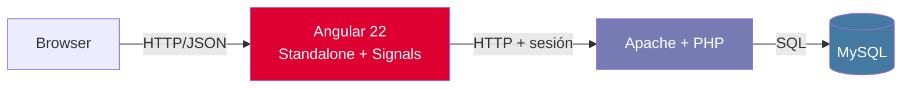

<div align="center">

# 🚀 AngPHP — Angular 22 + PHP/MySQL Dashboard


**Una aplicación full-stack moderna** construida con **Angular 22 (standalone)** y **PHP/MySQL (XAMPP)** para gestión de clientes, sucursales y ventas.

[🎯 Demo en vivo](#-capturas) • [⚡ Inicio Rápido](#-inicio-rápido) • [🏗️ Arquitectura](#️-arquitectura) • [📁 Estructura](#-estructura-del-proyecto) • [🔧 Scripts](#-scripts-disponibles)

</div>

---

## ✨ Características

| Módulo | Descripción |
|--------|-------------|
| 🏠 **Home** | Dashboard de bienvenida con accesos rápidos |
| 👥 **Clientes** | Listado, búsqueda y estado (activo/inactivo) |
| 🏢 **Sucursales** | Catálogo con dirección y cantidad de empleados |
| 💰 **Ventas** | Registro histórico con totales, fecha y detalles |
| 🔄 **Datos en tiempo real** | Conexión HTTP a API PHP + recarga manual |
| 🔐 **Acceso por roles** | Home público, vendedor con acceso a Ventas y administrador con acceso completo |
| 🎨 **UI/UX** | Diseño responsivo, tablas estilizadas, estados de carga/error/vacío |

---

## 🔐 Autenticación y permisos

El Home es público y muestra el botón **Iniciar sesión** en la esquina superior derecha. Al iniciar sesión, el menú y las rutas disponibles dependen del rol:

| Rol | Acceso |
|-----|--------|
| Visitante (sin iniciar sesión) | Home |
| `vendedor` | Ventas; después de iniciar sesión se redirige directamente allí |
| `administrador` | Home, Clientes, Sucursales y Ventas |

Los guards de Angular controlan la navegación de la interfaz y PHP comprueba la sesión y el rol en cada endpoint. La sesión se mantiene mediante una cookie PHP `HttpOnly`; cerrar sesión elimina la sesión del servidor.

Las contraseñas se verifican y almacenan con bcrypt usando `password_verify()` y `password_hash()`. El usuario inicial del SQL de ejemplo es `admin` con contraseña `123456`; cambiá esa contraseña antes de publicar la aplicación. En bases anteriores que tengan la contraseña inicial en texto plano, el primer login correcto la actualiza a bcrypt.

Los endpoints PHP aceptan solicitudes con credenciales desde `http://localhost:4200` y `http://127.0.0.1:4200`. Si tu frontend usa otro origen, agregalo a la lista permitida de `api_auth.php`.

---

## ⚡ Inicio Rápido

### Prerrequisitos
- **Node.js** ≥ 18.x
- **npm** ≥ 9.x
- **XAMPP** (Apache + MySQL/MariaDB) corriendo en `http://localhost`
- **Angular CLI** `npm i -g @angular/cli@22`

### 1. Base de datos (MySQL)
Importá `programacion2.sql` desde phpMyAdmin en una base llamada `programacion2`. El volcado contiene las tablas y un usuario de prueba. Si usás otra base o credenciales, actualizá `conexion2.php`.

### 2. Backend PHP (XAMPP)
```bash
# Copiá los archivos PHP del backend a esta carpeta
C:\xampp\htdocs\bd-sucur\
```

El backend debe incluir estos archivos en `C:\xampp\htdocs\bd-sucur\`:
```
bd-sucur/
├── api_auth.php
├── Login.php
├── Logout.php
├── Get_Meses.php
├── Get_Sucus.php
├── Get_Clientes.php
├── Get_Ventas.php
├── conexion2.php
└── programacion2.sql
```

### 3. Frontend Angular
```bash
# Clona el repo
git clone https://github.com/maariasGH/Angular-prog2.git
cd Angular-prog2

# Instala dependencias
npm install

# Levanta el servidor de desarrollo
npm start
# → http://localhost:4200/
```

El frontend usa `http://localhost/bd-sucur/` como URL de API (ver `src/app/api-url.ts`). Apache y MySQL/MariaDB deben estar activos. Para otra instalación o dominio, actualizá esa URL y la lista CORS de `api_auth.php`.

### Endpoints y permisos

| Endpoint | Permiso |
|----------|---------|
| `Login.php` / `Logout.php` | Acceso público para iniciar o cerrar sesión |
| `Get_Ventas.php` | `administrador` y `vendedor` |
| `Get_Clientes.php` | `administrador` |
| `Get_Sucus.php` | `administrador` |
| `Get_Meses.php` | `administrador` |

---

## 🏗️ Arquitectura



### Patrones clave
- **Standalone Components** – Sin `NgModule`, `bootstrapApplication`
- **Signals** – `signal()`, `computed()`, `effect()` para reactividad fina
- **Service `providedIn: 'root'`** – Singleton HTTP (`ArticulosService`)
- **Sesión PHP + CORS con credenciales** – Autenticación y autorización del lado del servidor
- **CSS Variables + Inter Font** – Design system consistente
- **Control Flow Syntax** – `@if`, `@for`, `@switch` en templates

---

## 📁 Estructura del Proyecto

```
src/
├── app/
│   ├── app.config.ts           # Providers: router, HttpClient, zone
│   ├── app-routing.module.ts   # Rutas y guards por rol
│   ├── app.component.*         # Layout principal (header, nav, router-outlet)
│   ├── articulos.service.ts    # Servicio HTTP centralizado
│   ├── auth/                   # Sesión de usuario y guards
│   ├── login/                  # Formulario de ingreso
│   ├── home/                   # Componente Home
│   ├── clientes/               # Listado de clientes
│   ├── lista-sucursales/       # Listado de sucursales
│   └── ventas/                 # Listado de ventas
├── styles.css                  # Estilos globales + design tokens
├── main.ts                     # Bootstrap standalone
└── index.html
```

### Rutas
| Path | Componente | Datos |
|------|------------|-------|
| `/home` | `HomeComponent` | Público; solo administrador permanece aquí al iniciar sesión |
| `/clientes` | `ClientesComponent` | Administrador |
| `/sucursales` | `ListaSucursalesComponent` | Administrador |
| `/ventas` | `VentasComponent` | Administrador y vendedor |

---

## 🔧 Scripts Disponibles

| Comando | Descripción |
|---------|-------------|
| `npm start` | `ng serve` – Dev server con HMR en `localhost:4200` |
| `npm run build` | `ng build` – Build producción en `dist/` |
| `npm run watch` | Build en modo watch (dev) |
| `npm test` | `ng test` – Tests unitarios con Vitest |

---

## 🎨 Design System (CSS Variables)

```css
:root {
  --primary: #2563eb;       /* Azul principal */
  --primary-hover: #1d4ed8;
  --success: #10b981;       /* Verde éxito */
  --warning: #f59e0b;       /* Ámbar advertencia */
  --danger: #ef4444;        /* Rojo error */
  --bg: #f8fafc;            /* Fondo app */
  --card-bg: #ffffff;       /* Fondo tarjetas */
  --text: #1e293b;          /* Texto principal */
  --text-muted: #64748b;    /* Texto secundario */
  --border: #e2e8f0;        /* Bordes */
  --radius: 8px;            /* Radio estándar */
  --radius-lg: 12px;        /* Radio tarjetas */
  --shadow: 0 1px 3px rgba(0,0,0,.1);
  --transition: all .2s ease;
}
```

Cada feature tiene su **CSS scoped** (`*.component.css`) con tema de color propio:
- **Clientes** → Azul (`--primary`)
- **Sucursales** → Verde (`--success`)
- **Ventas** → Ámbar (`--warning`)

---

## 🐛 Troubleshooting Común

| Problema | Solución |
|----------|----------|
| **Botones no navegan** | Verificá `routerLink` en `app.component.html` y las rutas/guards en `app-routing.module.ts` |
| **"Cargando..." infinito** | Revisa consola (F12) → Network → llamadas a `/bd-sucur/…` |
| **CORS o cookie de sesión** | Usá `localhost:4200` o `127.0.0.1:4200`, verificá que Apache esté activo y que el origen figure en `api_auth.php` |
| **Puerto 4200 ocupado** | `netstat -ano \| findstr :4200` → `taskkill /F /PID <PID>` |
| **Datos vacíos** | Confirma que `Get_Clientes.php` y `Get_Ventas.php` existan y devuelvan JSON válido |
| **Estilos rotos** | `npm run build` limpio + hard reload (Ctrl+Shift+R) |

---

## 📦 Build para Producción

```bash
npm run build
# Artefactos en dist/mi-proyecto-nuevo/
# Sube la carpeta a tu hosting estático (Netlify, Vercel, Firebase, Apache, Nginx)
```

**Nota:** En producción configura tu servidor web para servir `index.html` en rutas desconocidas (SPA fallback).

---

## 🤝 Contribuir

1. Fork el repo
2. Crea tu rama: `git checkout -b feature/mi-feature`
3. Commit: `git commit -m 'feat: agrega mi feature'`
4. Push: `git push origin feature/mi-feature`
5. Abre un **Pull Request**

---

## 📄 Licencia

MIT License — Libre para uso personal, educativo y comercial.

---

## 👩‍💻 Autor

**Mariano Arias**  
📧 [ariasmariano100@gmail.com]  
🔗 [GitHub](https://github.com/maariasGH) · [LinkedIn](https://www.linkedin.com/in/mariano-arias-8bba0021b/)

---

<div align="center">

**¿Te sirvió el proyecto? ¡Dale una ⭐ en GitHub!**

[](https://github.com/maariasGH/Angular-prog2/stargazers)
[](https://github.com/maariasGH/Angular-prog2/network/members)

</div>
