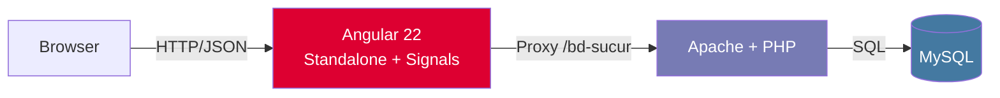

<div align="center">

# 🚀 AngPHP — Angular 22 + PHP/MySQL Dashboard


**Una aplicación full-stack moderna** construida con **Angular 22 (standalone)** y **PHP/MySQL (XAMPP)** para gestión de clientes, sucursales y ventas.

[🎯 Demo en vivo](#-capturas) • [⚡ Inicio Rápido](#-inicio-rápido) • [🏗️ Arquitectura](#️-arquitectura) • [📁 Estructura](#-estructura-del-proyecto) • [🔧 Scripts](#-scripts-disponibles)

</div>

---

## ✨ Características

| Módulo | Descripción |
|--------|-------------|
| 🏠 **Home** | Dashboard de bienvenida con accesos rápidos |
| 👥 **Clientes** | Listado, búsqueda y estado (activo/inactivo) |
| 🏢 **Sucursales** | Catálogo con dirección y cantidad de empleados |
| 💰 **Ventas** | Registro histórico con totales, fecha y detalles |
| 🔄 **Datos en tiempo real** | Conexión HTTP a API PHP + recarga manual |
| 🎨 **UI/UX** | Diseño responsivo, tablas estilizadas, estados de carga/error/vacío |

---

## ⚡ Inicio Rápido

### Prerrequisitos
- **Node.js** ≥ 18.x
- **npm** ≥ 9.x
- **XAMPP** (Apache + MySQL) corriendo en `http://localhost`
- **Angular CLI** `npm i -g @angular/cli@22`

### 1. Base de datos (MySQL)
```sql
-- En phpMyAdmin o MySQL CLI
CREATE DATABASE bd_sucursales CHARACTER SET utf8mb4 COLLATE utf8mb4_unicode_ci;
USE bd_sucursales;

-- Tablas de ejemplo (ajusta a tu esquema real)
CREATE TABLE meses (id INT AUTO_INCREMENT PRIMARY KEY, nombre VARCHAR(20));
CREATE TABLE sucursales (
  Id_Suc INT AUTO_INCREMENT PRIMARY KEY,
  Nombre_Suc VARCHAR(100),
  Dir_Suc VARCHAR(200),
  Cant_Emp_Suc INT
);
CREATE TABLE clientes (...);
CREATE TABLE ventas (...);
```

### 2. Backend PHP (XAMPP)
```bash
# Copia la carpeta del backend a htdocs
cp -r backend/ C:/xampp/htdocs/bd-sucur/
# O en Windows: copia manualmente a C:\xampp\htdocs\bd-sucur\
```

**Estructura esperada en `C:\xampp\htdocs\bd-sucur\`:**
```
bd-sucur/
├── Get_Meses.php
├── Get_Sucus.php
├── Get_Clientes.php
├── Get_Ventas.php
└── CORS_EJEMPLO.php   ← referencia para headers CORS
```

> **Importante:** Cada `Get_*.php` debe incluir los headers CORS (ver `CORS_EJEMPLO.php`) y manejar `OPTIONS`:
```php
header("Access-Control-Allow-Origin: http://localhost:4200");
header("Access-Control-Allow-Methods: GET, OPTIONS");
header("Access-Control-Allow-Headers: Content-Type");
if ($_SERVER['REQUEST_METHOD'] === 'OPTIONS') { exit(0); }
```

### 3. Frontend Angular
```bash
# Clona el repo
git clone https://github.com/maariasGH/Angular-prog2.git
cd Angular-prog2

# Instala dependencias
npm install

# Levanta el servidor de desarrollo
npm start
# → http://localhost:4200/
```

### 4. Proxy de desarrollo (ya configurado)
`proxy.conf.json` redirige `/bd-sucur/*` → `http://localhost/bd-sucur/*` evitando CORS en dev.

---

## 🏗️ Arquitectura



### Patrones clave
- **Standalone Components** – Sin `NgModule`, `bootstrapApplication`
- **Signals** – `signal()`, `computed()`, `effect()` para reactividad fina
- **Service `providedIn: 'root'`** – Singleton HTTP (`ArticulosService`)
- **Proxy + CORS** – Dev sin problemas de origen cruzado
- **CSS Variables + Inter Font** – Design system consistente
- **Control Flow Syntax** – `@if`, `@for`, `@switch` en templates

---

## 📁 Estructura del Proyecto

```
src/
├── app/
│   ├── app.config.ts           # Providers: router, HttpClient, zone
│   ├── app.routes.ts           # Rutas: /home, /clientes, /sucursales, /ventas
│   ├── app.component.*         # Layout principal (header, nav, router-outlet)
│   ├── articulos.service.ts    # Servicio HTTP centralizado
│   ├── home/                   # Componente Home
│   ├── clientes/               # Listado de clientes
│   ├── lista-sucursales/       # Listado de sucursales
│   └── ventas/                 # Listado de ventas
├── styles.css                  # Estilos globales + design tokens
├── main.ts                     # Bootstrap standalone
└── index.html
```

### Rutas
| Path | Componente | Datos |
|------|------------|-------|
| `/home` | `HomeComponent` | — |
| `/clientes` | `ClientesComponent` | `Get_Clientes.php` |
| `/sucursales` | `ListaSucursalesComponent` | `Get_Sucus.php` |
| `/ventas` | `VentasComponent` | `Get_Ventas.php` |

---

## 🔧 Scripts Disponibles

| Comando | Descripción |
|---------|-------------|
| `npm start` | `ng serve` – Dev server con HMR en `localhost:4200` |
| `npm run build` | `ng build` – Build producción en `dist/` |
| `npm run watch` | Build en modo watch (dev) |
| `npm test` | `ng test` – Tests unitarios con Vitest |

---

## 🎨 Design System (CSS Variables)

```css
:root {
  --primary: #2563eb;       /* Azul principal */
  --primary-hover: #1d4ed8;
  --success: #10b981;       /* Verde éxito */
  --warning: #f59e0b;       /* Ámbar advertencia */
  --danger: #ef4444;        /* Rojo error */
  --bg: #f8fafc;            /* Fondo app */
  --card-bg: #ffffff;       /* Fondo tarjetas */
  --text: #1e293b;          /* Texto principal */
  --text-muted: #64748b;    /* Texto secundario */
  --border: #e2e8f0;        /* Bordes */
  --radius: 8px;            /* Radio estándar */
  --radius-lg: 12px;        /* Radio tarjetas */
  --shadow: 0 1px 3px rgba(0,0,0,.1);
  --transition: all .2s ease;
}
```

Cada feature tiene su **CSS scoped** (`*.component.css`) con tema de color propio:
- **Clientes** → Azul (`--primary`)
- **Sucursales** → Verde (`--success`)
- **Ventas** → Ámbar (`--warning`)

---

## 🐛 Troubleshooting Común

| Problema | Solución |
|----------|----------|
| **Botones no navegan** | Verifica `routerLink` en `app.component.html` y rutas en `app.routes.ts` |
| **"Cargando..." infinito** | Revisa consola (F12) → Network → llamadas a `/bd-sucur/…` |
| **CORS bloqueado** | Añade headers en *todos* los PHP + maneja `OPTIONS` |
| **Puerto 4200 ocupado** | `netstat -ano \| findstr :4200` → `taskkill /F /PID <PID>` |
| **Datos vacíos** | Confirma que `Get_Clientes.php` y `Get_Ventas.php` existan y devuelvan JSON válido |
| **Estilos rotos** | `npm run build` limpio + hard reload (Ctrl+Shift+R) |

---

## 📦 Build para Producción

```bash
npm run build
# Artefactos en dist/mi-proyecto-nuevo/
# Sube la carpeta a tu hosting estático (Netlify, Vercel, Firebase, Apache, Nginx)
```

**Nota:** En producción configura tu servidor web para servir `index.html` en rutas desconocidas (SPA fallback).

---

## 🤝 Contribuir

1. Fork el repo
2. Crea tu rama: `git checkout -b feature/mi-feature`
3. Commit: `git commit -m 'feat: agrega mi feature'`
4. Push: `git push origin feature/mi-feature`
5. Abre un **Pull Request**

---

## 📄 Licencia

MIT License — Libre para uso personal, educativo y comercial.

---

## 👩‍💻 Autor

**Mariano Arias**  
📧 [ariasmariano100@gmail.com]  
🔗 [GitHub](https://github.com/maariasGH) · [LinkedIn](https://www.linkedin.com/in/mariano-arias-8bba0021b/)

---

<div align="center">

**¿Te sirvió el proyecto? ¡Dale una ⭐ en GitHub!**

[](https://github.com/maariasGH/Angular-prog2/stargazers)
[](https://github.com/maariasGH/Angular-prog2/network/members)

</div>
